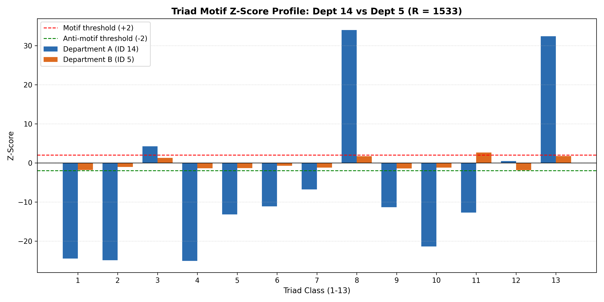

# Finding Network Motifs in an Email Network

**CS1005 – Discrete Structures (Fall 2026) Course Project**

This project looks for network motifs (over-represented three-node patterns) in the directed *email-Eu-core* network. It compares the communication structure of two departments by counting directed triads and testing them against randomized networks.

## Group Members

| Name           | Roll No. |
|----------------|----------|
| Hussain Abbas  | 24i-0788 |
| Ghulam Hussain | 24i-0745 |

Group number: `R = 788 + 745 = 1533`

## Assigned Parameters (R = 1533)

| Parameter                                  | Value                      |
|--------------------------------------------|----------------------------|
| Pair number (`R mod 190`)                  | 13 (top-20 indices 0 and 14) |
| Department A                               | 14                         |
| Department B                               | 5                          |
| Random networks (`20 + R mod 31`)          | 34                         |
| Swap-attempt multiplier (`5 + R mod 6`)    | 8                          |
| Random seed                                | 1533                       |

## Method

1. **Load and clean** the edge list and department labels. Self-loops and duplicate edges are removed.
2. **Rank departments** by their number of internal edges. The top 20 are paired in lexicographic order and the pair is picked using `R mod 190`.
3. **Extract the induced subgraph** of each assigned department.
4. **Triad census.** Every connected triple of nodes is classified into one of the 13 connected directed triad classes. Each class has a canonical code: the smallest 6-bit edge code over all 6 node orderings.
5. **Randomization.** Double-edge swaps generate random graphs that keep every node's in-degree and out-degree. Swaps that would create self-loops or duplicate edges are rejected, and rejected swaps still count as attempts. Network *i* uses seed `R + i`, so results are reproducible.
6. **Z-scores.** For each class, `Z = (actual − mean_random) / std_random`, using the population standard deviation. If the standard deviation is 0, Z is 0.
7. **Classification.** `Z > 2` is a **motif**, `Z < −2` is an **anti-motif**, and anything else is **neither**.
8. **Visualization.** A grouped bar chart of the Z-scores for both departments, with dashed lines at ±2.

## Project Structure

```
Discrete-project/
├── data/
│   ├── email-Eu-core.txt                    # directed edge list
│   └── email-Eu-core-department-labels.txt  # node -> department
├── results/
│   └── motif_zscores_R1533.png              # output chart (T7)
├── src/
│   ├── graph_utils.py     # loading, cleaning, ranking, parameter derivation, subgraphs
│   ├── motifs.py          # triad classification and census
│   ├── randomization.py   # degree-preserving double-edge swaps
│   ├── significance.py    # Z-score computation
│   ├── visualization.py   # grouped bar chart
│   └── main.py            # runs the full pipeline
├── verify_census.py       # checks our census against NetworkX
├── requirements.txt
└── README.md
```

## Hand Example for `triad_class` (T3)

Take the directed 3-cycle on nodes `a, b, c` with edges `a→b`, `b→c`, `c→a`. The bits are 0:`0→1`, 1:`0→2`, 2:`1→0`, 3:`1→2`, 4:`2→0`, 5:`2→1`.

- Ordering `(x0, x1, x2) = (a, b, c)`: the edges `0→1` (bit 0), `1→2` (bit 3) and `2→0` (bit 4) are present, so the code is 1 + 8 + 16 = **25**.
- Ordering `(a, c, b)`: the edges are `0→2` (bit 1), `2→1` (bit 5) and `1→0` (bit 2), so the code is 2 + 32 + 4 = **38**.
- The other four orderings give 25 or 38 as well (a cyclic relabelling keeps the code, a reversal gives 38).
- The minimum over all 6 orderings is **25**, which is the 9th entry in the sorted code list `3, 6, 7, 10, 11, 15, 21, 23, 25, ...`, so the triad is **Class 9**.

`triad_class(0, 1, 2, {(0,1), (1,2), (2,0)})` returns `9`.

## Requirements

- Python 3.9 or newer
- `matplotlib`
- `networkx` (used **only** in `verify_census.py` to check our T4 counts against `nx.triadic_census`, as allowed by the project statement. All triad classification, counting, randomization and Z-score code is our own.)

## Installation

```bash
git clone https://github.com/hussainabbas00/Discrete-project.git
cd Discrete-project

# optional but recommended
python -m venv venv
source venv/bin/activate        # Windows: venv\Scripts\activate

pip install -r requirements.txt
```

## Usage

Run everything from the project root, because the code imports from the `src` package.

**Run the full analysis**

```bash
python -m src.main
```

This prints the project parameters, the department subgraph sizes, the triad census, the Z-scores and the motif classification. It also saves the chart to `results/motif_zscores_R1533.png`.

**Verify the triad census against NetworkX**

```bash
python -m verify_census
```

This compares our census with `networkx.triadic_census` for Departments 14 and 5, and prints `All verification checks passed!` if they match.

## Results

The Z-score comparison chart is saved at `results/motif_zscores_R1533.png`.



### T8: Comparison of Department Communication

Department A (ID 14) exhibits a more varied and pronounced motif profile than Department B (ID 5). Department A has three significant motifs (classes 3, 8 and 13), while Department B has only one (class 11). Department A also has nine anti-motifs (classes 1, 2, 4, 5, 6, 7, 9, 10 and 11), meaning these patterns occur significantly less often than expected in randomized networks with the same in- and out-degrees. In Department B, every class except class 11 is neither a motif nor an anti-motif.

The motifs explain the difference. All three of Department A's motifs are built from **reciprocal (two-way) emails**:

- **Class 3 (Z ≈ 4.3):** a mutual pair in which one of the two also sends to a third person.
- **Class 8 (Z ≈ 34.0):** one person in two-way contact with two others who are not connected to each other.
- **Class 13 (Z ≈ 32.4):** a fully mutual triangle, where all three people email each other in both directions.

Classes 8 and 13 have by far the largest Z-scores. This shows that Department A communicates in tight, reciprocal groups rather than through one-way messages. This matches its anti-motifs. Classes 1, 2 and 4 are one-way patterns with no reciprocation, and class 9 is the one-way 3-cycle. These all occur far less often than chance would predict (Z between −11 and −25). Class 11 is also an anti-motif there (Z ≈ −12.7).

Department B's only motif is **class 11 (Z ≈ 2.7)**, in which one person sends to both members of a mutual pair. This is a one-way sender pattern rather than a fully reciprocal group. The Z-scores of its other classes stay between about −1.8 and +1.8, so it shows little structure beyond what its degree sequence already produces. Department B is also much smaller (18 nodes and 147 edges, against 92 nodes and 1,506 edges for Department A), so it has fewer triads and its Z-scores are less likely to reach ±2. Part of the difference may therefore come from size rather than from real differences in behaviour.

These conclusions come from comparing the real counts with the randomized networks (Z-scores), not from raw triad counts alone. For example, class 3 has the highest raw count in Department A (5,105), but it is only mildly over-represented (Z ≈ 4.3).

## Hand Example for `triad_class` (T3)

Take the directed 3-cycle on nodes `a, b, c` with edges `a→b`, `b→c`, `c→a`. The bits are 0:`0→1`, 1:`0→2`, 2:`1→0`, 3:`1→2`, 4:`2→0`, 5:`2→1`.

- Ordering `(x0, x1, x2) = (a, b, c)`: the edges `0→1` (bit 0), `1→2` (bit 3) and `2→0` (bit 4) are present, so the code is 1 + 8 + 16 = **25**.
- Ordering `(a, c, b)`: the edges are `0→2` (bit 1), `2→1` (bit 5) and `1→0` (bit 2), so the code is 2 + 32 + 4 = **38**.
- The other four orderings give 25 or 38 as well (a cyclic relabelling keeps the code, a reversal gives 38).
- The minimum over all 6 orderings is **25**, which is the 9th entry in the sorted code list `3, 6, 7, 10, 11, 15, 21, 23, 25, ...`, so the triad is **Class 9**.

`triad_class(0, 1, 2, {(0,1), (1,2), (2,0)})` returns `9`.

## Requirements

- Python 3.9 or newer
- `matplotlib`
- `networkx` (used **only** in `verify_census.py` to check our T4 counts against `nx.triadic_census`, as allowed by the project statement. All triad classification, counting, randomization and Z-score code is our own.)

## Installation

```bash
git clone https://github.com/hussainabbas00/Discrete-project.git
cd Discrete-project

# optional but recommended
python -m venv venv
source venv/bin/activate        # Windows: venv\Scripts\activate

pip install -r requirements.txt
```

## Usage

Run everything from the project root, because the code imports from the `src` package.

**Run the full analysis**

```bash
python -m src.main
```

This prints the project parameters, the department subgraph sizes, the triad census, the Z-scores and the motif classification. It also saves the chart to `results/motif_zscores_R1533.png`.

**Verify the triad census against NetworkX**

```bash
python -m verify_census
```

This compares our census with `networkx.triadic_census` for Departments 14 and 5, and prints `All verification checks passed!` if they match.

## Results

The Z-score comparison chart is saved at `results/motif_zscores_R1533.png`.


### T8: Comparison of Department Communication

Department A exhibits a more varied and pronounced motif profile than Department B. It has three significant motifs (classes 3, 8, and 13), while Department B has only one significant motif (class 11). Department A also has several anti-motifs, indicating that certain communication patterns occur significantly less often than expected under the random network model. In contrast, most triad classes in Department B are neither motifs nor anti-motifs. This suggests that Department A has more distinctively structured communication patterns, whereas Department B has fewer statistically significant patterns. These differences are identified using Z-scores from the randomized networks, rather than raw triad counts alone.

## Contributions

| Member         | Work done |
|----------------|-----------|
| Hussain Abbas  |T1-T4 & T8 & video |
| Ghulam Hussain |T5-T7 & video |

## Dataset

[email-Eu-core](https://snap.stanford.edu/data/email-Eu-core.html) from the Stanford SNAP collection. It is a directed network of email communication between members of a European research institution, with department labels for each node.